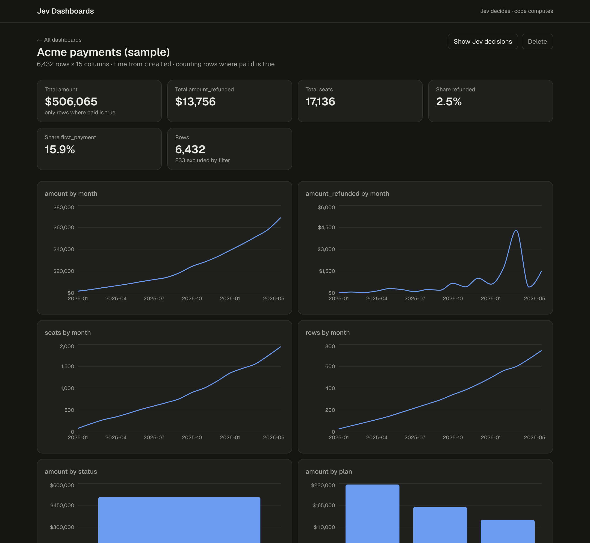
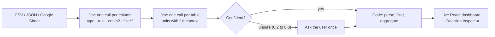
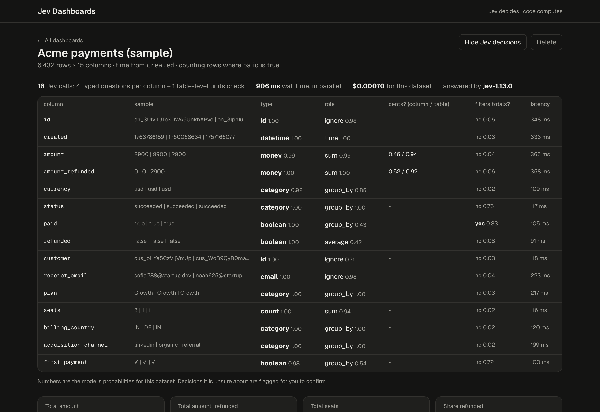
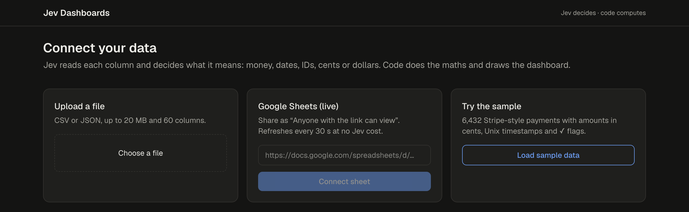

<div align="center">

# Jev Dashboards

**Drop in a messy CSV or Google Sheet. Get a live dashboard in seconds.**<br>
A decision model decides what every column means. Code does the maths.




</div>

## The problem

Founders keep their numbers in Stripe exports, product-event dumps and hand-maintained Google
Sheets. Turning those into a dashboard takes hours, and the usual shortcuts get the numbers wrong:

| On the bundled 6,432-row sample export | Total revenue | `created` column |
| --- | --- | --- |
| pandas default type inference | **52,508,600** (cents read as dollars, failed payments counted) | a plain integer, so no timeline |
| **This app** | **$506,065**, matches the source data | read as a date |

Asking a general LLM to plan every query works, but it spends a lot of time and tokens on what
are really small, typed decisions.

## How it works

Every "what is this?" question becomes a **typed decision**: a multiple-choice or yes/no
question answered with a probability. The decisions are made by
[Jev](https://typesafe.ai), a decision model from TypeSafe AI, called through its public API.
Everything numeric happens in plain code, never in the model.





The **Decision Inspector** shows every decision behind the dashboard with its probability, so
nothing the model decided is hidden from the user.

### Design choices

- **Types per column, units per table.** Whether `2900` means $29 or $2,900 often can't be told
  from one column, so unit questions are asked once per table with headers and a few full rows.
- **Ask when unsure.** Any unit decision between 0.2 and 0.8 shows a banner, and the user's
  answer is stored and always wins.
- **The model never does arithmetic.** Dates, money formats (`1.234,56 €`, `($1,140.12)`, cents)
  and booleans (✓/✗) are parsed by tested code, following the model's
  [documented limitations](https://docs.typesafe.ai/model-jaggedness/jev-1.13).

## Evaluation harness

[`eval/`](eval/README.md) is a reproducible harness for testing **any** column-typing decision
layer (rules, gradient boosting, an LLM, or a decision model) on your own data:

- **Data:** 324 founder-style columns across 10 export layouts (Stripe, Shopify, CRM, ads,
  analytics, KPI sheets, EU invoices and more), with every hard case tagged; plus 530 real public
  columns (GitTables, UCI) ready for human labeling.
- **Metrics:** accuracy with grouped bootstrap CIs, calibration (ECE, Brier, reliability
  diagrams), risk-coverage curves, cost-optimal deferral thresholds and paired McNemar tests.
- **Robustness:** sample size, missing and misleading headers, option order and option naming.

## What I learned (educational notes)

> **Read this first.** This is a personal learning project, not an official, independent or
> peer-reviewed benchmark. The figures below come from one run in October 2026 with
> `jev-1.13.0`, on my own small and mostly **synthetic** test set (324 columns I generated from
> documented export formats). They show what I observed while learning, not how Jev performs in
> general, on your data, or in later versions. Run the harness yourself before drawing conclusions.

On my synthetic founder-style columns, compared with two simple baselines I wrote:

| My test set, one run | Rules | Gradient boosting | Jev |
| --- | --- | --- | --- |
| Accuracy (95% CI) | 75.6% | 70.7% | 95.4% (91.5 to 98.6) |
| Calibration error (ECE, lower is better) | 0.117 | 0.193 | 0.018 |
| Share of decisions automatable at 5% error | 0% | 8% | 100% |

Things I noticed, and what they taught me about designing around a decision model:

- **Misleading headers mattered most.** When I gave columns headers that named the wrong type,
  accuracy on my set dropped to about 78% and answers stayed confident. Lesson: don't let a header
  alone decide; the roadmap's "ask twice" rule targets this.
- **Units need context.** For `amount` alone the model's p(cents) was 0.46; with the whole table
  (`ch_` and `cus_` IDs visible) it was 0.94. Lesson: ask unit questions at table level.
- **Weaker spots on my set:** fractional counts like `5.59` conversions and percentages written
  without a % sign. These match the kinds of limits the
  [model's own documentation](https://docs.typesafe.ai/model-jaggedness/jev-1.13) describes.
- **Option order and naming barely changed answers** on my set (0.3% of answers flipped when
  options were shuffled), which suggested definitions mattered more than names.

These are notes from a small experiment. Synthetic data is cleaner than real exports, and my
baselines are deliberately simple, so stronger baselines or real data could change the picture.

## Quick start

```bash
git clone https://github.com/sukritisehgal-28/jev-dashboards.git && cd jev-dashboards

# backend
cd app/backend && python3 -m venv .venv
.venv/bin/pip install -e ../../eval -e ".[dev]"
echo "TYPESAFE_API_KEY=your-key" > .env       # get one at console.typesafe.ai/keys
.venv/bin/uvicorn jevdash.api:app --port 8000   # or JEV_MOCK=1 for a free offline mode

# frontend (new terminal)
cd app/web && npm install && npm run dev        # http://localhost:3000
```



Jev spend is capped (default $1.00, `JEV_BUDGET_USD`) and logged. Decisions are cached per
dataset, so a live Google Sheet refreshing every 30 seconds costs nothing extra.

## Repository

| Path | What |
| --- | --- |
| [`app/backend/`](app/README.md) | FastAPI: sources, Jev client with spend cap, parsing, dashboard spec |
| `app/web/` | Next.js 15 + Recharts frontend |
| [`eval/`](eval/README.md) | Evaluation harness: rules, gradient boosting, LLM and decision-model tiers; calibration, risk-coverage, robustness |
| [`demo/`](demo/README.md) | One-command CSV → dashboard HTML, with the naive-vs-Jev comparison |

## Roadmap

- [x] Column typing, units and filter decisions with Jev; confidence-gated user confirmation
- [x] Upload, Google Sheets (live) and sample sources
- [x] Evaluation harness with calibration, risk-coverage and robustness tests
- [ ] "Ask twice" rule for misleading headers (ask with and without the header, flag disagreement)
- [ ] Claude agent to answer questions about the dashboard, using numbers computed in code
- [ ] Neon Postgres connector
- [ ] Human-labeled real-data benchmark

## Notes

- Jev is a product and trademark of TypeSafe AI. This is an independent personal project, not
  affiliated with, sponsored or endorsed by TypeSafe AI. Use of Jev is subject to
  [TypeSafe's terms](https://typesafe.ai/legal/mca); bring your own API key.
- Figures in this README are informal, educational observations from a personal project. They
  are not performance claims, guarantees or an endorsement, and raw model outputs are not committed.
- Public datasets are CC BY 4.0; attribution in [`eval/data/starter/SOURCES.md`](eval/data/starter/SOURCES.md).

Built by [Sukriti Sehgal](https://github.com/sukritisehgal-28).
