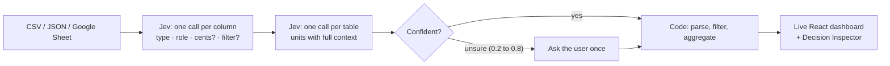

<div align="center">

# Jev Dashboards

**Drop in a messy CSV or Google Sheet. Get a live dashboard in seconds.**<br>
[TypeSafe's Jev](https://typesafe.ai) decides what every column means. Code does the maths.


</div>

## The problem

Founders keep their numbers in Stripe exports, product-event dumps and hand-maintained Google
Sheets. Turning those into a dashboard takes hours, and the usual shortcuts get the numbers wrong:

| On the same 6,432-row payments export | Total revenue | `created` column |
| --- | --- | --- |
| pandas default type inference | **52,508,600** (cents read as dollars, failed payments counted) | a plain integer, so no timeline |
| Rules-based column typing | correct type, but no units or filter logic | `count` |
| **Jev Dashboards** | **$506,065**, matches ground truth | `datetime` |

Asking a general LLM to plan every query works, but it is slow and burns tokens on what are
really small, typed decisions.

## How it works

Every "what is this?" question is a **typed decision**, which is exactly what Jev is built for:
it answers multiple-choice and yes/no questions with calibrated probabilities in about 100 to
350 ms, at $0.042 per million input tokens. Everything numeric happens in plain code.




The **Decision Inspector** shows every answer Jev gave, with its probability, latency and cost.
Loading the sample took 16 calls, 0.9 s and **$0.0007**.

## What we measured

This repo includes an independent evaluation of Jev as a pipeline decision layer
([`eval/`](eval/README.md)): 324 founder-style columns across 10 export layouts (Stripe, Shopify,
CRM, ads, analytics, KPI sheets, EU invoices and more), each hard case tagged, scored against
rules and a gradient-boosted baseline.

| | Rules | Gradient boosting | **Jev** |
| --- | --- | --- | --- |
| Accuracy (95% CI) | 75.6% | 70.7% | **95.4%** (91.5 to 98.6) |
| Calibration error (ECE, lower is better) | 0.117 | 0.193 | **0.018** |
| Decisions safely automated at 5% error | 0% | 8% | **100%** |
| Cost per 1,000 decisions | free | free | **$0.034** |

Jev beat both baselines (exact McNemar test, p < 1e-15). It read Unix timestamps,
amounts in cents, `1.234,56 €`, `($1,140.12)`, ✓/✗ flags and `00:01:55` durations correctly.

**Where Jev loses** (reported, not hidden):

- **Misleading headers.** When a column's header names the wrong type, accuracy falls from 95% to
  78%, and Jev stays confident while wrong.
- **Fractional counts** like `5.59` conversions, and **percentages without a % sign**.
- **Units need context.** Looking at `amount` alone, Jev gave p(cents) = 0.46. Given the whole
  table (`ch_` and `cus_` IDs), 0.94. So the app asks unit questions at table level.
- Not a weakness: shuffling options changed 0.3% of answers, and swapping option names left
  accuracy at 95.7%. Jev followed the definitions, not the names.

> Synthetic data caveat: the founder slice is generated from documented export formats, with
> labels from the generator. A 530-column slice of real public tables (GitTables, UCI) is ready
> for human labeling in [`eval/data/starter/`](eval/data/starter/SOURCES.md).

## Quick start

```bash
git clone https://github.com/sukritisehgal-28/jev-dashboards.git && cd jev-dashboards

# backend
cd app/backend && python3 -m venv .venv
.venv/bin/pip install -e ../../eval -e ".[dev]"
echo "TYPESAFE_API_KEY=your-key" > .env       # get one at console.typesafe.ai/keys
.venv/bin/uvicorn jevdash.api:app --port 8000   # or JEV_MOCK=1 for a free offline mode

# frontend (new terminal)
cd app/web && npm install && npm run dev        # http://localhost:3000
```


Jev spend is capped (default $1.00, `JEV_BUDGET_USD`) and logged. Decisions are cached per
dataset, so a live Google Sheet refreshing every 30 seconds costs nothing extra.

## Repository

| Path | What |
| --- | --- |
| [`app/backend/`](app/README.md) | FastAPI: sources, Jev client with spend cap, parsing, dashboard spec |
| `app/web/` | Next.js 15 + Recharts frontend |
| [`eval/`](eval/README.md) | Evaluation harness: 4 model tiers, calibration, risk-coverage, robustness variants |
| [`demo/`](demo/README.md) | One-command CSV → dashboard HTML, with the naive-vs-Jev comparison |
| `research_notes/`, `reports/` | Research on Jev, TypeSafe's terms and documented failure modes |

## Roadmap

- [x] Column typing, units and filter decisions with Jev; confidence-gated user confirmation
- [x] Upload, Google Sheets (live) and sample sources
- [x] Independent evaluation with calibration and failure analysis
- [ ] "Ask twice" rule for misleading headers (ask with and without the header, flag disagreement)
- [ ] Claude agent to answer questions about the dashboard, using numbers computed in code
- [ ] Neon Postgres connector
- [ ] Human-labeled real-data benchmark

## Notes

- Jev is a product of TypeSafe AI. This project is independent and not affiliated with or endorsed by TypeSafe.
- Public datasets are CC BY 4.0; attribution in [`eval/data/starter/SOURCES.md`](eval/data/starter/SOURCES.md).
- Raw Jev outputs are not committed; only aggregate metrics are reported.

Built by [Sukriti Sehgal](https://github.com/sukritisehgal-28).
